# Rapport de TP : Clusterisation de conteneurs

- **Module :** Clusterisation de conteneurs, ESGI Lyon, 5ESGI
- **Auteur :** Pelavo (plvo)
- **Dépôt :** https://github.com/plvo/esgi-2603-my-favorite-places
- **Images :** [`plvo/mfp-server:1.0`](https://hub.docker.com/r/plvo/mfp-server) et [`plvo/mfp-client:1.0`](https://hub.docker.com/r/plvo/mfp-client)

Ce rapport suit la numérotation des exercices. Les commandes ont été lancées depuis la machine hôte avec `docker exec`, ce qui revient à ouvrir un terminal dans le conteneur. Les sorties complètes sont dans [`rapport/sorties/`](sorties/) et les stacks dans [`swarm/`](../swarm/).

Aucun secret réel ne figure dans ce dépôt : les jetons sont masqués dans les sorties, et les fichiers sensibles restent dans `swarm/.local/`, ignoré par Git.

## Récapitulatif

| Cours | Exercice | État |
| --- | --- | --- |
| 1 | TD 1 Dockerisation, TD 2 fiabilité et optimisation | Fait |
| 2 | TD 1 DinD et DooD, TD 2 cluster, TD 3 tests | Fait |
| 4 | Ex. 1 Traefik, Ex. 2 voting app, Ex. 3 Portainer, Ex. 4 redéploiement et MFP | Fait |
| 5 | Ex. 1.1 Dozzle, Ex. 1.2 Authelia et OIDC | Fait |
| 5 | Ex. 1.3 Outline (bonus) | Non traité |

| Application | URL | Réponse |
| --- | --- | --- |
| Dashboard Traefik | http://traefik.swarm.localhost/dashboard/ | 200 |
| Whoami | http://whoami.swarm.localhost/ | 200 |
| Vote | http://vote.swarm.localhost/ | 200 |
| Résultats | http://result.swarm.localhost/ | 200 |
| Portainer | http://portainer.swarm.localhost/ | 200 |
| Front MFP | http://mfp.swarm.localhost/ | 200 |
| API MFP | http://api.swarm.localhost/api/users/me | 403 sans jeton, comportement attendu |
| Dozzle | https://dozzle.swarm.localhost/login | 200 |
| Authelia | https://authelia.swarm.localhost/ | 200 |

État final du cluster :

```text
$ docker exec swarm-manager-1 docker service ls --format "table {{.Name}}\t{{.Mode}}\t{{.Replicas}}\t{{.Image}}"
NAME                  MODE         REPLICAS   IMAGE
authelia_authelia     replicated   1/1        authelia/authelia:4.39
dozzle_dozzle         global       4/4        amir20/dozzle:v11.4.0
mfp_client            replicated   2/2        plvo/mfp-client:1.0
mfp_db                replicated   1/1        postgres:17
mfp_server            replicated   2/2        plvo/mfp-server:1.0
portainer_agent       global       4/4        portainer/agent:lts
portainer_portainer   replicated   1/1        portainer/portainer-ce:lts
traefik_traefik       replicated   1/1        traefik:v3.6
traefik_whoami        replicated   1/1        traefik/whoami:latest
vote_db               replicated   1/1        postgres:15-alpine
vote_redis            replicated   1/1        redis:alpine
vote_result           replicated   1/1        dockersamples/examplevotingapp_result:latest
vote_vote             replicated   2/2        dockersamples/examplevotingapp_vote:latest
vote_worker           replicated   2/2        dockersamples/examplevotingapp_worker:latest
```

## Cours 1 : Dockerisation

Le détail est dans [`DOCKER.md`](../DOCKER.md).

### TD 1 : Dockerisation

`server/Dockerfile`, `client/Dockerfile` et `compose.yml` lancent le serveur, le client et PostgreSQL.

```text
$ docker compose ps
SERVICE   STATUS                   PORTS
client    Up 6 seconds             0.0.0.0:8080->80/tcp, [::]:8080->80/tcp
db        Up 8 seconds (healthy)   5432/tcp
server    Up 6 seconds             0.0.0.0:3000->3000/tcp, [::]:3000->3000/tcp

$ curl -X POST http://localhost:8080/api/users -H 'Content-Type: application/json' -d '{"email":"demo@local.test","password":"demo-password"}'
{"item":{"id":1,"email":"demo@local.test","hashedPassword":"<hash>","createdAt":"2026-11-04T11:50:40.933Z"}}
HTTP 200
```


**Comment communiquent la BDD et le serveur ?** En TCP sur le réseau créé par Compose. Le serveur joint la BDD par le nom du service (`db`), résolu par le DNS interne de Docker, sur le port 5432, qui n'est pas publié sur l'hôte. `localhost` désignerait le conteneur du serveur lui-même.

**Et le serveur et le front ?** Le navigateur appelle `/api/...` en relatif sur le port du front. nginx relaie vers `http://server:3000`, par le DNS interne. Il n'y a donc pas de CORS à gérer.

### TD 2 : Fiabilité et optimisation

1. **Démarrage ordonné :** un `healthcheck` `pg_isready` sur `db`, et `depends_on` avec `condition: service_healthy` sur `server`.
2. **Redémarrage automatique :** `restart: unless-stopped` sur les trois services.

   ```text
   $ docker inspect <conteneur> --format '{{.HostConfig.RestartPolicy.Name}}'
   db unless-stopped
   server unless-stopped
   client unless-stopped
   ```

3. **Build stages :** le serveur est compilé dans un stage `build`, et l'image finale ne garde que `dist/` et les dépendances de production, sur une base Alpine. L'objectif de -100 Mo est dépassé.

| Image serveur | Taille |
| --- | --- |
| `node:22-slim`, multi-stage | 550 Mo |
| `node:22-alpine`, multi-stage, cache yarn vidé | 334 Mo |

L'image client fait 94 Mo : le stage Node est jeté et il ne reste que nginx avec les fichiers statiques.

### Prérequis du cours 2 : images sur un registry

`docker stack deploy` ne construit pas d'images, et chaque nœud doit pouvoir les télécharger.

```bash
docker build -t plvo/mfp-server:1.0 server
docker build -t plvo/mfp-client:1.0 client
docker push plvo/mfp-server:1.0
docker push plvo/mfp-client:1.0
```

Deux corrections ont été faites à cette étape :

- **Code de sortie du serveur :** sans BDD, le processus se terminait avec le code 0. Une politique Swarm `on-failure` aurait pris cet échec pour un succès. Il sort maintenant avec le code 1.
- **`COPY . .` retiré du Dockerfile client**, comme le recommande le cours.

## Cours 2 : Docker Swarm

### TD 1 : DinD et DooD

| | Docker-in-Docker (DinD) | Docker-out-of-Docker (DooD) |
| --- | --- | --- |
| Principe | Un daemon Docker complet tourne dans le conteneur | Le socket `/var/run/docker.sock` de l'hôte est monté dans le conteneur |
| Conteneurs lancés | Enfants, dans le daemon du conteneur | Frères, sur le daemon de l'hôte |
| Isolation | Daemon séparé, mais `--privileged` rompt l'isolation avec l'hôte | Pas de séparation : accès au socket équivalent à root sur l'hôte |
| Usage typique | Simuler plusieurs machines | CI, outils comme Traefik et Portainer |

**Approche pour tester Swarm :** DinD, car chaque conteneur a son propre daemon et se comporte comme une machine distincte. Avec DooD, tous partageraient un seul daemon, donc un seul nœud. Compose lance ces « machines » et les relie par un réseau commun, sans coût cloud. `--privileged` étant risqué, ce montage reste réservé au local.

### TD 2 : Création du cluster

**1. Lancement.** Fichier [`swarm/compose.yml`](../swarm/compose.yml) :

```yaml
services:
  manager:
    image: docker:dind
    privileged: true
    hostname: manager
    ports:
      - "80:80"
      - "443:443"
    volumes:
      - /home/manager

  node:
    image: docker:dind
    privileged: true
    scale: 3
```

Le port 443 a été ajouté au cours 5. Le volume anonyme conserve les fichiers de `/home/manager`.

```text
$ docker compose up -d
$ docker ps --format "table {{.Names}}\t{{.Image}}\t{{.Status}}\t{{.Ports}}" --filter name=swarm-
NAMES             IMAGE         STATUS                  PORTS
swarm-manager-1   docker:dind   Up Less than a second   0.0.0.0:80->80/tcp, [::]:80->80/tcp, 2375-2376/tcp
swarm-node-1      docker:dind   Up Less than a second   2375-2376/tcp
swarm-node-3      docker:dind   Up Less than a second   2375-2376/tcp
swarm-node-2      docker:dind   Up Less than a second   2375-2376/tcp

$ docker exec swarm-node-1 docker ps
CONTAINER ID   IMAGE     COMMAND   CREATED   STATUS    PORTS     NAMES
```

Docker fonctionne dans le conteneur, et son daemon est vide : c'est bien un daemon distinct de celui de l'hôte.

**2. Initialisation.**

```text
$ docker exec swarm-manager-1 docker swarm init
Swarm initialized: current node (rvkpoi5q67x28p1343k9mgi6s) is now a manager.

To add a worker to this swarm, run the following command:

    docker swarm join --token <TOKEN> 172.21.0.2:2377
```

**3. Ajout des workers**, par le nom du service et non par l'IP :

```text
$ docker exec swarm-node-1 docker swarm join --token <TOKEN> manager:2377
This node joined a swarm as a worker.
$ docker exec swarm-node-2 docker swarm join --token <TOKEN> manager:2377
This node joined a swarm as a worker.
$ docker exec swarm-node-3 docker swarm join --token <TOKEN> manager:2377
This node joined a swarm as a worker.
```

**4. État du cluster :**

```text
$ docker exec swarm-manager-1 docker node ls
ID                            HOSTNAME       STATUS    AVAILABILITY   MANAGER STATUS   ENGINE VERSION
e28xwqci5wxflocjog7066yj9     d0ada8f4a045   Ready     Active                          29.9.3
59n2ucz29gt124ptp8ojujrb6     ddc4456364e2   Ready     Active                          29.9.3
omgnnm2hagod7rs8effm3ze9d     de69559d8a5a   Ready     Active                          29.9.3
rvkpoi5q67x28p1343k9mgi6s *   manager        Ready     Active         Leader           29.9.3
```

### TD 3 : Tests du cluster

**1 et 2. Stack hello-world.** Fichier [`swarm/hello-world.compose.yml`](../swarm/hello-world.compose.yml), copié avec `docker cp` dans `/home/manager` :

```yaml
services:
  hello-world:
    image: hello-world
    deploy:
      replicas: 2
```

**3. Observation.**

```text
$ docker exec swarm-manager-1 docker service ls
ID             NAME                MODE         REPLICAS   IMAGE                PORTS
4pv9hm20b6r6   hello_hello-world   replicated   0/2        hello-world:latest

$ docker exec swarm-manager-1 docker service ps hello_hello-world ...
NAME                      NODE           DESIRED STATE   CURRENT STATE                      ERROR
hello_hello-world.1       de69559d8a5a   Ready           Preparing less than a second ago
 \_ hello_hello-world.1   de69559d8a5a   Shutdown        Complete less than a second ago
 \_ hello_hello-world.1   de69559d8a5a   Shutdown        Complete 6 seconds ago
 \_ hello_hello-world.1   de69559d8a5a   Shutdown        Complete 11 seconds ago
 \_ hello_hello-world.1   manager        Shutdown        Complete 17 seconds ago
 \_ hello_hello-world.1   manager        Shutdown        Complete 22 seconds ago
```

`docker ps -a` sur chaque nœud montre des conteneurs `Exited (0)` sur le manager, `node-1` et `node-2`, et aucun sur `node-3`.

**Ce qu'on en déduit :**

- Swarm répartit seul les tâches sur les nœuds, sans qu'on les désigne. Toutes les machines ne sont pas forcément utilisées.
- `hello-world` affiche son message puis s'arrête. Swarm cherche à maintenir 2 réplicas, donc il relance les tâches en boucle, parfois sur un autre nœud. Le service reste à `0/2`, car aucune tâche ne dure.
- Un service répliqué doit donc être un processus de longue durée.

**4. Variantes de `deploy`.** Elles utilisent une image qui reste active, `nmatsui/hello-world-api`, pour observer un placement stable.

| Variante | Fichier | Résultat |
| --- | --- | --- |
| 2 réplicas | [`hello-replicas.compose.yml`](../swarm/hello-replicas.compose.yml) | `2/2`, sur `manager` et `de69559d8a5a` |
| Manager uniquement | [`hello-manager.compose.yml`](../swarm/hello-manager.compose.yml) | `1/1`, sur `manager` |
| Global | [`hello-global.compose.yml`](../swarm/hello-global.compose.yml) | `4/4`, une tâche sur chaque nœud |

```text
$ docker exec swarm-manager-1 docker service ps helloglobal_hello --filter desired-state=running ...
NAME                                          NODE           CURRENT STATE            ERROR
helloglobal_hello.59n2ucz29gt124ptp8ojujrb6   ddc4456364e2   Running 20 seconds ago
helloglobal_hello.e28xwqci5wxflocjog7066yj9   d0ada8f4a045   Running 20 seconds ago
helloglobal_hello.omgnnm2hagod7rs8effm3ze9d   de69559d8a5a   Running 24 seconds ago
helloglobal_hello.rvkpoi5q67x28p1343k9mgi6s   manager        Running 24 seconds ago
```

## Cours 4 : Traefik et Portainer

Entrée ajoutée au fichier `/etc/hosts` de la machine (le port 80 de l'hôte doit être libre) :

```text
127.0.0.1 traefik.swarm.localhost whoami.swarm.localhost vote.swarm.localhost result.swarm.localhost portainer.swarm.localhost mfp.swarm.localhost api.swarm.localhost dozzle.swarm.localhost authelia.swarm.localhost
```

### Exercice 1 : Déployer Traefik

La stack [`swarm/traefik.yml`](../swarm/traefik.yml) reprend celle fournie dans le cours. Traefik lit le socket Docker et tourne donc sur le manager, seul à connaître l'état du Swarm.

```text
$ docker exec swarm-manager-1 docker network create -d overlay --attachable web
$ docker cp traefik.yml swarm-manager-1:/home/manager/traefik.yml
$ docker exec swarm-manager-1 docker stack deploy --detach=true -c /home/manager/traefik.yml traefik
Creating service traefik_traefik
Creating service traefik_whoami

$ docker exec swarm-manager-1 docker stack services traefik
ID             NAME              MODE         REPLICAS   IMAGE                   PORTS
2h5tu673cef8   traefik_traefik   replicated   1/1        traefik:v3.6            *:80->80/tcp
9ucy19b91y73   traefik_whoami    replicated   1/1        traefik/whoami:latest

$ curl -s http://whoami.swarm.localhost/
Hostname: de1834f82d3f
...
GET / HTTP/1.1
Host: whoami.swarm.localhost
X-Forwarded-Host: whoami.swarm.localhost
X-Forwarded-Proto: http
```

Le chemin complet est le suivant : le fichier hosts résout le nom vers 127.0.0.1, le port 80 de l'hôte mène au conteneur manager, le routing mesh du Swarm mène à Traefik, et Traefik choisit le service d'après l'en-tête `Host`.

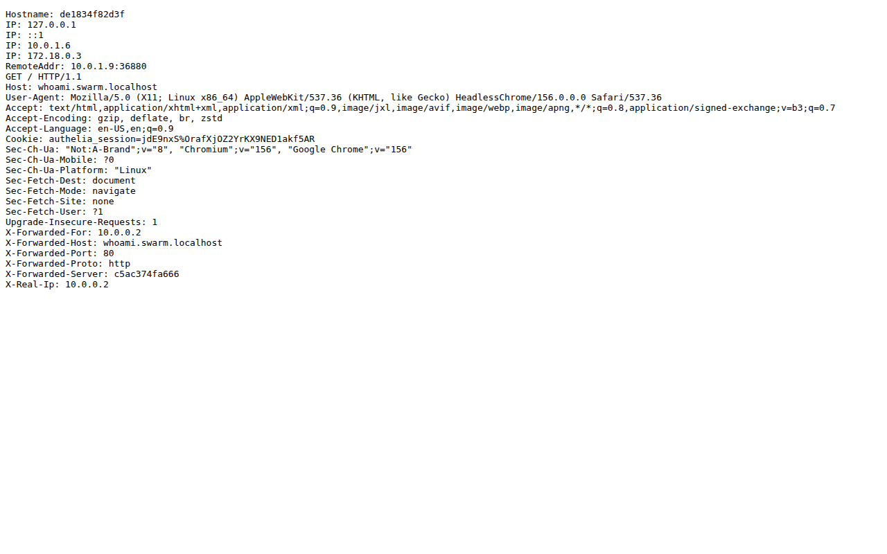

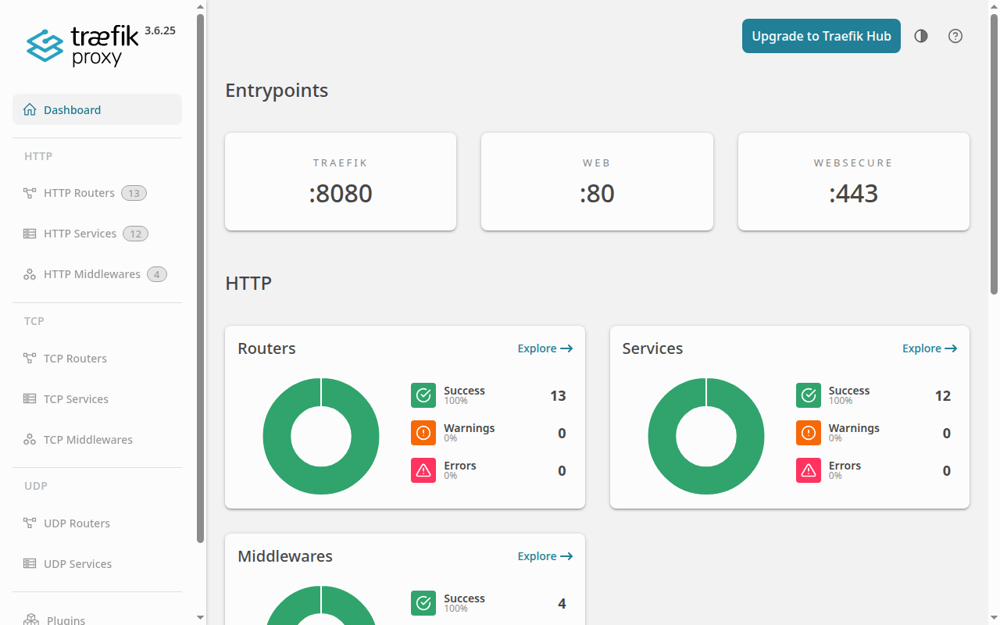

Les routeurs sont découverts à partir des labels, sans configuration centrale :

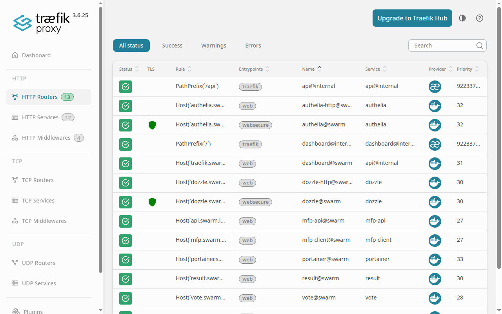

### Exercice 2 : Déployer une autre application

**1. Test en Compose, hors Swarm.**

```text
$ docker compose ps
SERVICE   STATUS                    PORTS
db        Up 45 seconds (healthy)   5432/tcp
redis     Up 44 seconds (healthy)   6379/tcp
result    Up 39 seconds             127.0.0.1:9229->9229/tcp, 0.0.0.0:8081->80/tcp, [::]:8081->80/tcp
vote      Up 39 seconds (healthy)   0.0.0.0:8080->80/tcp, [::]:8080->80/tcp
worker    Up 39 seconds
```

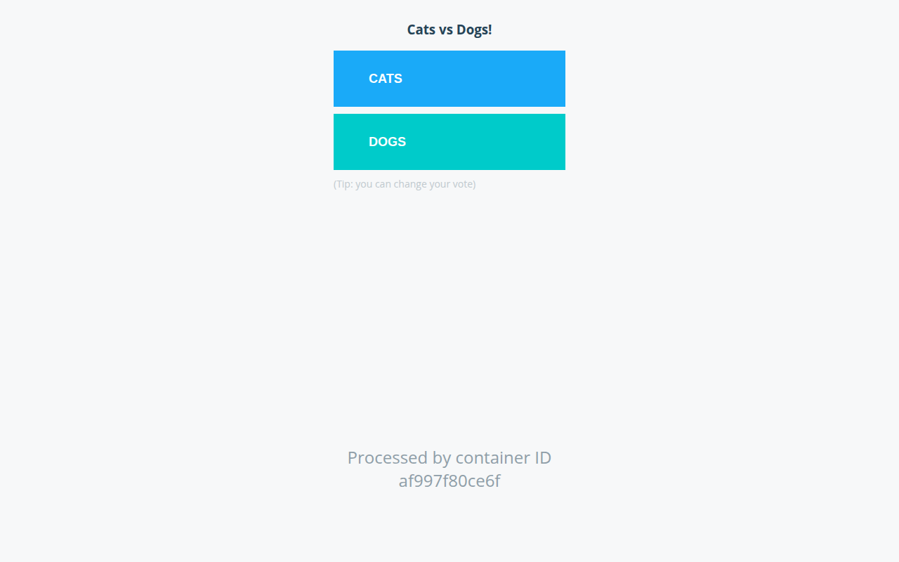

**Fonctionnement :** `vote` (Python) écrit le vote dans `redis`. `worker` (.NET) le lit et l'enregistre dans `db` (PostgreSQL). `result` (Node) lit `db` et affiche le résultat. Le réseau `frontend` relie `vote`, `redis` et `worker`, et le réseau `backend` relie `worker`, `db` et `result`.

**2 et 3. Déploiement sur Swarm avec 2 URL.** Dans [`swarm/voting.yml`](../swarm/voting.yml), les ports publiés de `vote` et `result` sont retirés. Ces deux services rejoignent le réseau `web` et reçoivent les labels Traefik :

```yaml
vote:
  image: dockersamples/examplevotingapp_vote
  networks:
    - frontend
    - web
  deploy:
    replicas: 2
    labels:
      - "traefik.enable=true"
      - "traefik.http.routers.vote.rule=Host(`vote.swarm.localhost`)"
      - "traefik.http.routers.vote.entrypoints=web"
      - "traefik.http.services.vote.loadbalancer.server.port=80"
```

```text
$ docker exec swarm-manager-1 docker stack ps vote --filter desired-state=running ...
NAME            NODE           CURRENT STATE            ERROR
vote_db.1       de69559d8a5a   Running 40 seconds ago
vote_redis.1    ddc4456364e2   Running 43 seconds ago
vote_result.1   d0ada8f4a045   Running 45 seconds ago
vote_vote.1     manager        Running 39 seconds ago
vote_vote.2     ddc4456364e2   Running 40 seconds ago
vote_worker.1   d0ada8f4a045   Running 43 seconds ago
vote_worker.2   ddc4456364e2   Running 43 seconds ago
```

Les services sont répartis sur les 4 nœuds et communiquent par les réseaux overlay.


Les votes envoyés à `vote.swarm.localhost` apparaissent ici, ce qui valide toute la chaîne :

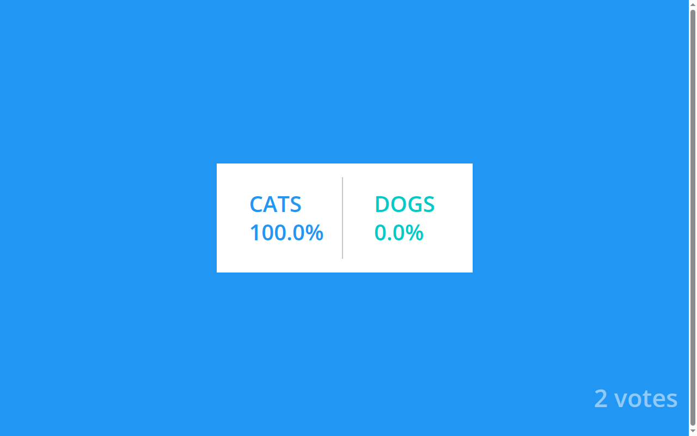

### Exercice 3 : Déployer Portainer

La stack [`swarm/portainer.yml`](../swarm/portainer.yml) vient de la documentation officielle. On y ajoute le réseau `web` et les labels Traefik vers le port 9000.

```text
$ docker exec swarm-manager-1 docker stack deploy --detach=true -c /home/manager/portainer.yml portainer
Creating network portainer_agent_network
Creating service portainer_agent
Creating service portainer_portainer

$ docker exec swarm-manager-1 docker stack services portainer
ID             NAME                  MODE         REPLICAS   IMAGE                        PORTS
v87x4dty41fm   portainer_agent       global       4/4        portainer/agent:lts
75tmetgus6zx   portainer_portainer   replicated   1/1        portainer/portainer-ce:lts   *:8000->8000/tcp, *:9000->9000/tcp, *:9443->9443/tcp
```

L'agent tourne sur chaque nœud (`global`), et l'interface sur le manager. Cette version demande un jeton d'installation à la création du compte administrateur : il se trouve dans les logs du service.

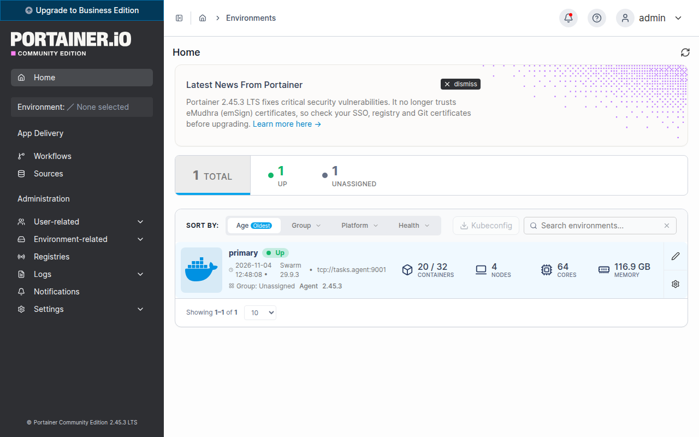

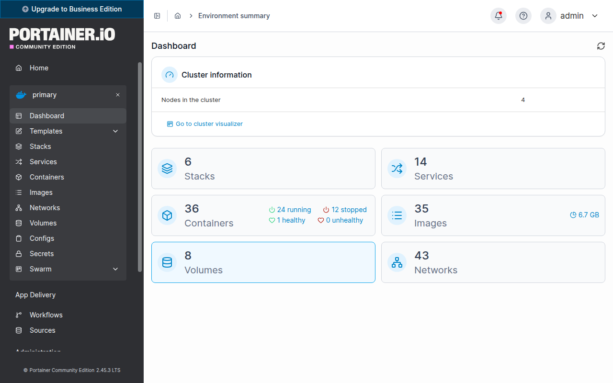

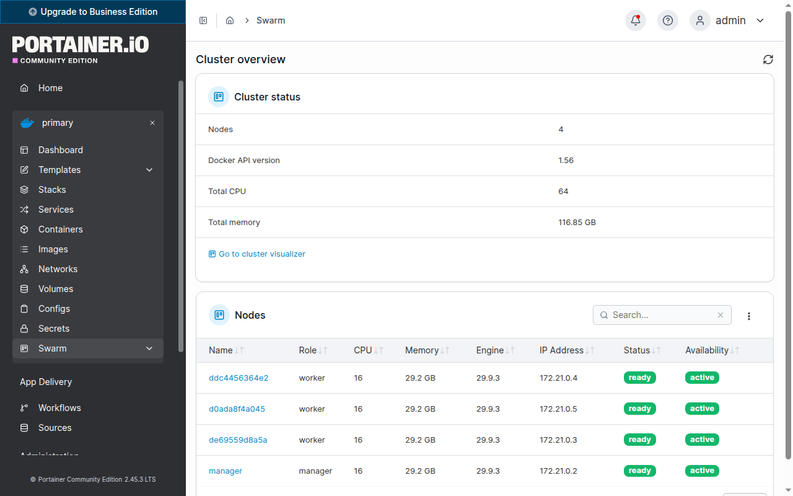

### Exercice 4 : Redéployer l'application de vote

**1. Suppression en ligne de commande.**

```text
$ docker exec swarm-manager-1 docker stack rm vote
Removing service vote_db
Removing service vote_redis
Removing service vote_result
Removing service vote_vote
Removing service vote_worker
Removing network vote_frontend
Removing network vote_backend

$ docker exec swarm-manager-1 docker stack ls
NAME        SERVICES
portainer   2
traefik     2
```

**2 et 3. Republication depuis Portainer :** Stacks, Add stack, Web editor.

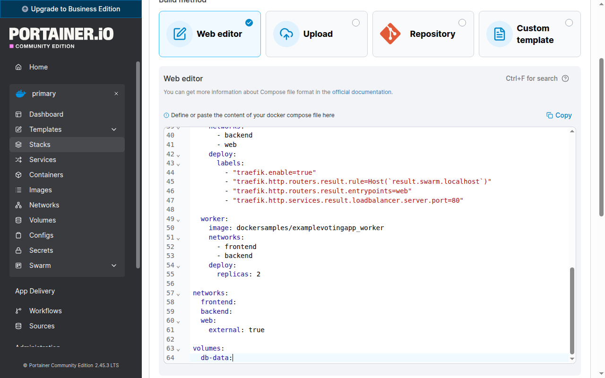

`http://vote.swarm.localhost/` répond de nouveau 200. Dans la liste, `vote` et `mfp`, créées depuis Portainer, sont en contrôle total. Les stacks déployées en ligne de commande sont en contrôle limité.

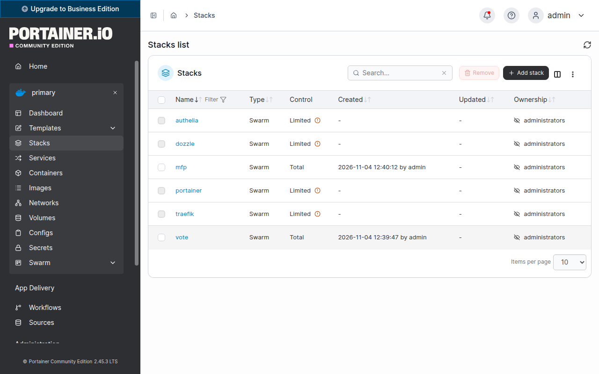

**4. Stack My Favorite Places.** [`swarm/mfp.yml`](../swarm/mfp.yml) déploie l'API sur `api.swarm.localhost` et, en plus de ce qui est demandé, le front sur `mfp.swarm.localhost`. Elle est créée depuis Portainer.

```text
$ docker exec swarm-manager-1 docker stack ps mfp ...
NAME               NODE           DESIRED STATE   CURRENT STATE            ERROR
mfp_client.1       de69559d8a5a   Running         Running 34 seconds ago
 \_ mfp_client.1   de69559d8a5a   Shutdown        Failed 40 seconds ago    "task: non-zero exit (1)"
mfp_client.2       d0ada8f4a045   Running         Running 39 seconds ago
mfp_db.1           manager        Running         Running 37 seconds ago
mfp_server.1       d0ada8f4a045   Running         Running 33 seconds ago
 \_ mfp_server.1   d0ada8f4a045   Shutdown        Failed 38 seconds ago    "task: non-zero exit (1)"
mfp_server.2       ddc4456364e2   Running         Running 35 seconds ago
 \_ mfp_server.2   ddc4456364e2   Shutdown        Failed 40 seconds ago    "task: non-zero exit (1)"
```

Ces échecs sont instructifs. Swarm ignore `depends_on` : le serveur a démarré avant la BDD, s'est arrêté avec le code 1, et a été relancé jusqu'à ce que la BDD soit prête. Sans le correctif du code de sortie, la politique `on-failure` ne l'aurait jamais relancé. Le raisonnement est le même pour le client : nginx refuse de démarrer tant que le nom `server` n'existe pas, puis Swarm le relance.

Test de l'API avec curl, à travers Traefik :

```text
$ curl -X POST http://api.swarm.localhost/api/users -H "Content-Type: application/json" -d '{"email":"pelavo@swarm.localhost","password":"demo-password"}'
{"item":{"id":1,"email":"pelavo@swarm.localhost","hashedPassword":"<hash>","createdAt":"2026-11-04T11:41:00.061Z"}}
HTTP 200

POST /api/users/tokens HTTP 200
GET /api/users/me sans token HTTP 403
client HTTP 200
client vers API via nginx HTTP 403
```


## Cours 5 : Secrets et configs

### Pourquoi HTTPS a été ajouté

Authelia impose un `authelia_url` en `https://`, et son émetteur OIDC renvoie le navigateur vers des URL `https`. Le sujet donne des URL en HTTP, mais la connexion OIDC ne peut pas fonctionner sans TLS. Traefik reçoit donc un point d'entrée `websecure` sur le port 443, avec un certificat auto-signé pour `*.swarm.localhost`. HTTP redirige vers HTTPS pour Dozzle et Authelia. Le navigateur affiche un avertissement, ce qui est normal pour un certificat auto-signé en local.

Le certificat est lui-même un bon exemple de la différence entre config et secret : le certificat public est une **config**, sa clé privée est un **secret**.

Recréer le conteneur manager pour publier le port 443 n'a pas cassé le cluster : l'IP et l'état du Swarm ont été conservés, comme le montre la sortie de `docker node ls`.

### Secrets et configs créés

Authelia lit ses secrets depuis des fichiers (variables `*_FILE`) et le filtre `template` injecte le reste dans la configuration. Le fichier [`swarm/authelia-config.yml`](../swarm/authelia-config.yml) ne contient donc aucune valeur sensible.

```text
$ docker exec -i swarm-manager-1 docker secret create authelia_session_secret - < .local/authelia_session_secret
lgtukr2lq2l2ygdoc89usl7b9
$ docker exec -i swarm-manager-1 docker config create traefik_tls - < traefik-tls.yml
i2o9tdxtcfj6scaui2gfjahy5
```

Un secret n'est pas consultable, contrairement à une config :

```text
$ docker exec swarm-manager-1 docker secret inspect authelia_session_secret --format "{{json .Spec}}"
{"Name":"authelia_session_secret","Labels":{}}

$ docker exec swarm-manager-1 docker config inspect --pretty traefik_tls
Name:			traefik_tls
Data:
tls:
  stores:
    default:
      defaultCertificate:
        certFile: /etc/traefik/swarm.crt
        keyFile: /run/secrets/swarm_tls_key
```

Un secret n'est pas non plus modifiable. Une erreur dans le fichier d'utilisateurs d'Authelia a imposé cette séquence :

```text
$ docker exec swarm-manager-1 docker stack rm authelia
$ docker exec swarm-manager-1 docker secret rm authelia_users
$ docker exec -i swarm-manager-1 docker secret create authelia_users - < .local/authelia_users.yml
$ docker exec swarm-manager-1 docker stack deploy --detach=true -c /home/manager/authelia.yml authelia
```

### Exercice 1.1 : Dozzle avec un secret `users.yml`

Le fichier est généré avec `dozzle generate`, puis le secret `dozzle_users` est créé depuis Portainer (Secrets, Add secret). Il est monté sur `/data/users.yml` par [`swarm/dozzle.yml`](../swarm/dozzle.yml).

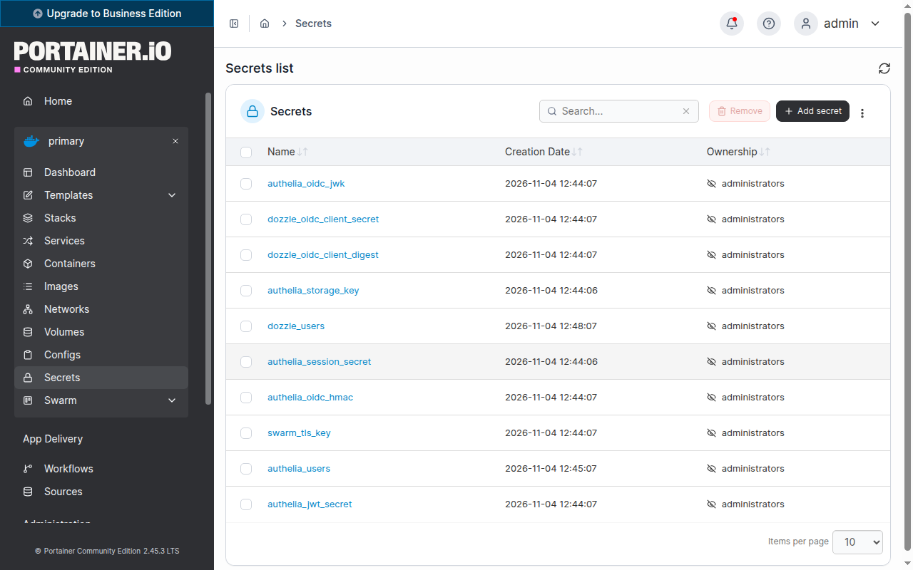

```text
$ docker exec swarm-manager-1 docker stack services dozzle
ID             NAME            MODE      REPLICAS   IMAGE                   PORTS
hjl4q32x85oa   dozzle_dozzle   global    4/4        amir20/dozzle:v11.4.0
```

Dozzle tourne en `global` (`DOZZLE_MODE=swarm`) pour voir les logs de tous les nœuds. Chaque instance génère son propre secret de session : un cookie de persistance (`sticky`) côté Traefik maintient donc le navigateur sur la même instance.

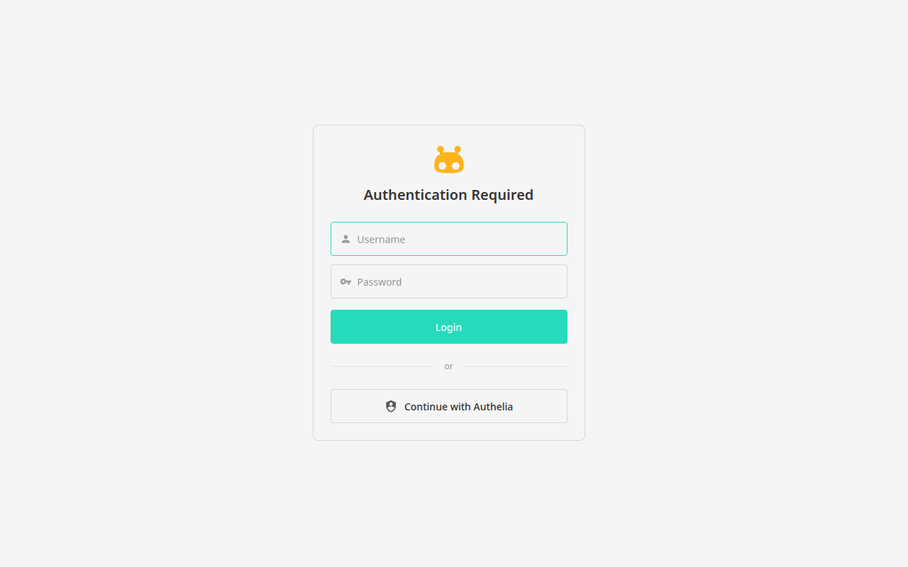

Après connexion avec le mot de passe de `users.yml` :

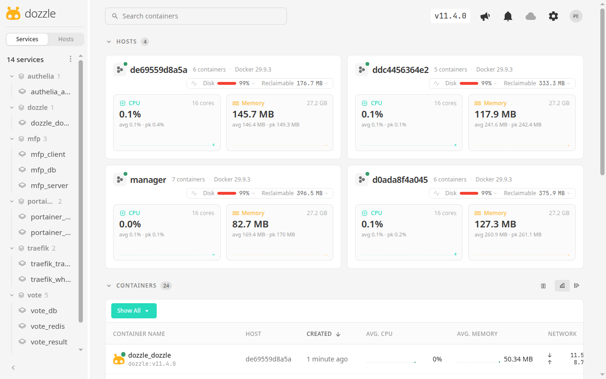

### Exercice 1.2 : Authelia et client OIDC

[`swarm/authelia.yml`](../swarm/authelia.yml) déploie Authelia avec le secret `authelia_users` (le compte) et la config `authelia_config`, qui déclare le client OIDC `dozzle` :

```yaml
clients:
  - client_id: 'dozzle'
    client_name: 'Dozzle'
    client_secret: '{{ secret "/run/secrets/dozzle_oidc_client_digest" }}'
    authorization_policy: 'one_factor'
    redirect_uris:
      - 'https://dozzle.swarm.localhost/api/auth/callback'
    scopes: ['openid', 'profile', 'email']
```

Dozzle garde le fournisseur `simple` : `users.yml` reste la liste des comptes autorisés, et le lien se fait sur l'adresse e-mail. Pour que Dozzle joigne l'émetteur depuis le cluster, Traefik porte l'alias réseau `authelia.swarm.localhost`, et Dozzle fait confiance au certificat grâce à `SSL_CERT_FILE`.

```text
$ curl -sk https://authelia.swarm.localhost/.well-known/openid-configuration | jq "{issuer, authorization_endpoint, token_endpoint}"
{
  "issuer": "https://authelia.swarm.localhost",
  "authorization_endpoint": "https://authelia.swarm.localhost/api/oidc/authorization",
  "token_endpoint": "https://authelia.swarm.localhost/api/oidc/token"
}
```

**Parcours testé dans un navigateur :**

1. Sur Dozzle, clic sur « Continue with Authelia ».
2. Connexion sur le portail Authelia avec le compte défini dans le secret :

   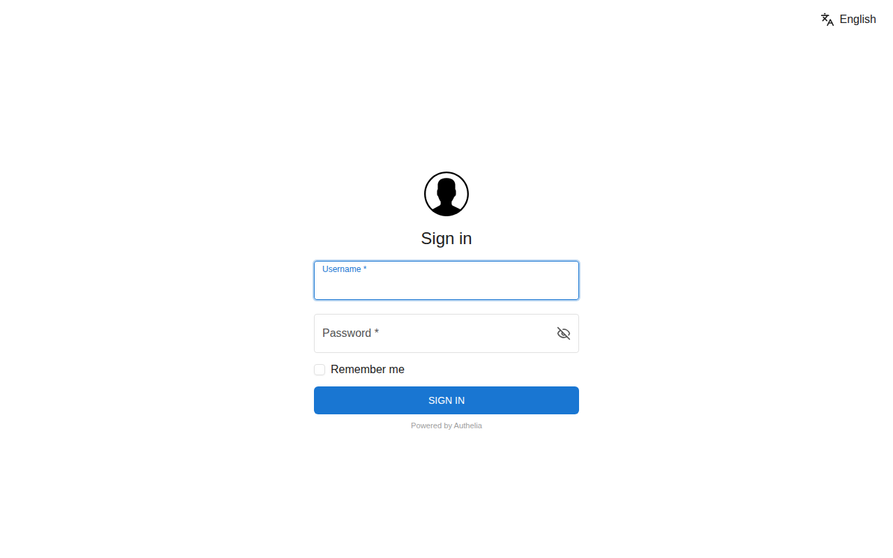

3. Validation du consentement pour le client `dozzle` :

   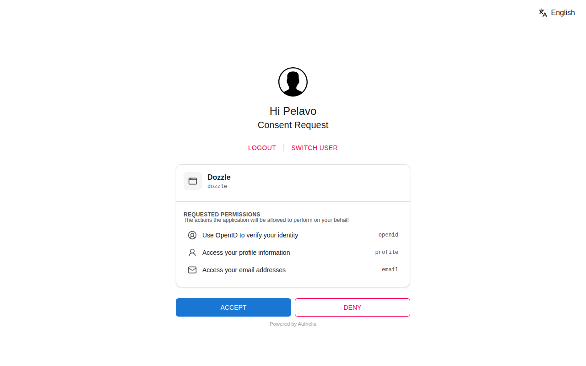

4. Retour sur Dozzle, connecté. Tous les nœuds et les 14 services sont visibles :

   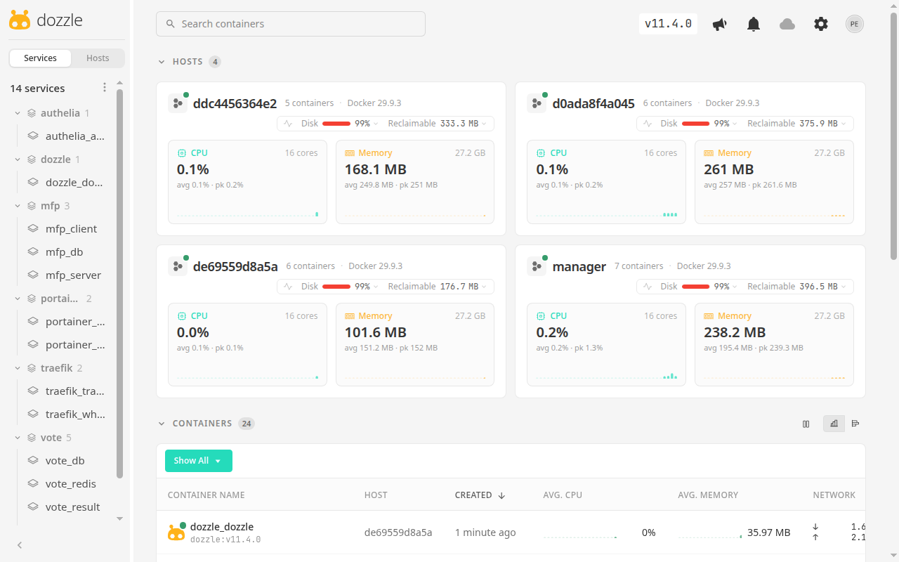

Le log de Dozzle confirme que la session vient bien d'OIDC :

```text
{"level":"info","version":"v11.4.0","user":"pelavo","provider":"oidc","time":"2026-11-04T11:49:16Z","message":"Token created"}
```

## Limites connues

Ce montage est adapté à un TP local, pas à la production :

- **`--privileged` et `--api.insecure=true`** sont acceptables en local uniquement.
- **Certificat auto-signé :** le navigateur affiche un avertissement.
- **Mot de passe en clair dans la stack MFP :** `DB_PASSWORD` y figure, et `SESSION_SECRET` garde sa valeur par défaut. Le serveur ne lit que des variables d'environnement. Il faudrait lui faire lire un fichier pour utiliser un secret Swarm.
- **Volumes locaux à un nœud :** `db-data` n'est pas répliqué. MFP contraint sa BDD sur le manager pour cette raison. La stack de vote ne le fait pas : ses données seraient perdues si la tâche changeait de nœud.
- **`synchronize: true`** dans TypeORM est déconseillé en production.
- **Mot de passe haché renvoyé par l'API :** `POST /api/users` inclut `hashedPassword` dans sa réponse. Ce problème vient du code de l'application et n'a pas été corrigé, car il sort du sujet.
- **Un seul manager :** pas de tolérance à sa panne. Raft demande une majorité de managers, il en faudrait 3 pour supporter une panne.

Ansible figure dans les objectifs du cours 2, mais aucun exercice ne le demande : l'initialisation du cluster reste manuelle ici.
